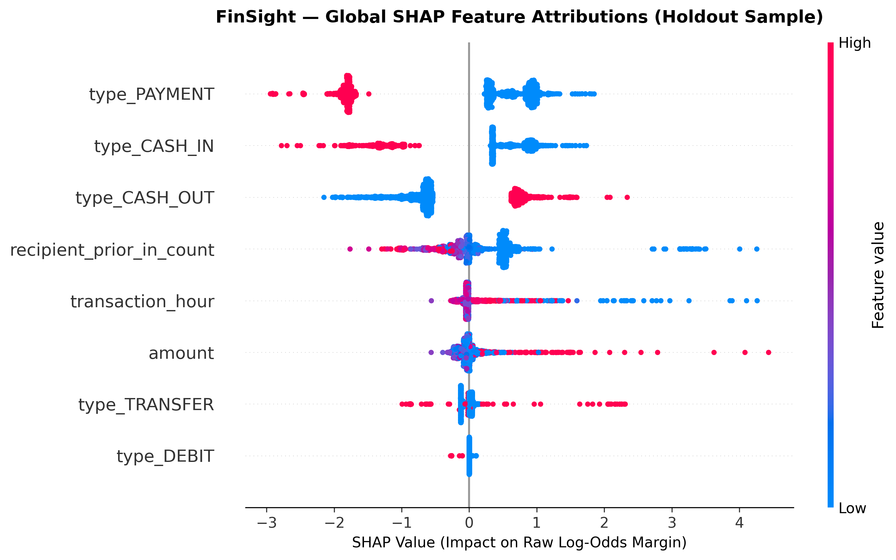

# FinSight — Model Explainability Report (TreeSHAP)

**Generated UTC:** 2026-11-20T06:46:16Z
**Model Artifact:** `models/hgb_e4_recipient.joblib` (HistGradientBoostingClassifier)
**Explainer Algorithm:** `TreeExplainer` (TreeSHAP exact additivity)
**Sample Population:** 2,000 development transactions (`551 <= step <= 650`; 22 labelled fraud, 1.100%; seed `42`; sealed final test excluded)
**Decision Threshold:** 0.9463
**Pipeline Runtime:** 25.58 seconds

---

## 1. Executive Summary & Governance

This report explains how FinSight's model turns transaction attributes into a risk score, using **TreeSHAP**
(Shapley Additive exPlanations), which assigns each feature its exact contribution to the model's raw output.

> [!IMPORTANT]
> **Non-causal explanations:** SHAP attributions describe the trained model on synthetic PaySim data. They show how
> feature values moved the model's log-odds score away from the background prior. They do **not** prove fraud,
> intent or causation.

### Model
- **Model explained:** the active champion `models/hgb_e4_recipient.joblib` (HistGradientBoosting baseline7 + recipient prior count (class weight 1:50)), as named in `models/champion.json` (sha256 `296132a5f543…`).
- **Why this model:** it passed the pre-registered one-time sealed test on steps 651-743 (average precision 0.6966 vs 0.4962 for the previous champion configuration; see `reports/final_test/p15_final_test.md`).
- **Decision threshold used here:** 0.9463 (fixed threshold calibrated to 100 alerts per simulated day on steps 551-650).
- **Sample window:** steps 551-650 are this model's calibration window, so the cases below explain model behaviour; they are not a performance estimate.

---

## 2. Mathematical Interpretation & Additivity Verification

- **Explanation Output Target:** Raw margin score (log-odds $\text{logit}(p) = \log\frac{p}{1-p}$).
- **Base Value (Expected Output):** $\mathbb{E}[f(x)] = -6.373753$ (Base score: **0.170%**; class-weighted training, so not a fraud rate).
- **Additivity Property:**
  $$f(x) = \phi_0 + \sum_{j=1}^M \phi_j(x)$$
- **Empirical Additivity Verification:** Max reconstruction error between `model.decision_function(X)` and the SHAP sum across all 2,000 sample rows is **`3.43e-14`**.

---

## 3. Global Feature Importance Ranking

Mean absolute SHAP value across the sample:
$$\text{Importance}_j = \frac{1}{N} \sum_{i=1}^N |\phi_j(x_i)|$$

| Rank | Feature Name | Mean |SHAP| (Log-Odds) | Attribution Share (%) |
| :---: | :--- | :---: | :---: |
| 1 | `type_PAYMENT` | 1.0656 | 31.1% |
| 2 | `type_CASH_IN` | 0.7971 | 23.3% |
| 3 | `type_CASH_OUT` | 0.7655 | 22.4% |
| 4 | `recipient_prior_in_count` | 0.3999 | 11.7% |
| 5 | `transaction_hour` | 0.1489 | 4.3% |
| 6 | `amount` | 0.1385 | 4.0% |
| 7 | `type_TRANSFER` | 0.1027 | 3.0% |
| 8 | `type_DEBIT` | 0.0054 | 0.2% |

### Top drivers in this run
1. `type_PAYMENT` — 31.1% of attribution: PAYMENT rail flag (no simulated fraud on this rail).
2. `type_CASH_IN` — 23.3% of attribution: CASH_IN rail flag (no simulated fraud on this rail).
3. `type_CASH_OUT` — 22.4% of attribution: CASH_OUT rail flag (one of the two rails where PaySim simulates fraud).
4. `recipient_prior_in_count` — 11.7% of attribution: payments the recipient received in earlier hours; first-time recipients score higher.

---

## 4. Global Attribution Distribution (Summary Beeswarm Plot)

Red = high feature value, blue = low; position = push towards (right) or away from (left) an alert.

---

## 5. Local Transaction Explanations (Analyst Audit Log)

### Case: True Positive (High Score Fraud)
- **Observed Transaction Profile (Real-World Attributes):**
  - Type: `TRANSFER`
  - Amount: `$3,571,807.73`
  - Simulated Timing: Day `24`, Hour `04:00`
  - Traceability IDs: Origin `N/A` $\to$ Destination `C1705119196` (Step: `557`)
- **Model Assessment (Uncalibrated Score):**
  - Raw Margin Score: `+4.3789` (vs. base prior `-6.3738`)
  - Model Decision Score (Sigmoid): **`98.76%`** (uncalibrated model score)
  - Decision Status: Locked Threshold `0.9463` $\implies$ **HIGH-RISK ALERT (Score: 0.9876 >= Threshold: 0.9463)**
  - Ground Truth Label: `isFraud = 1` (Retrospective holdout reference only)
- **Top Mathematical Attributions (SHAP Log-Odds Margin):**
  - Pushing higher towards alert: `recipient_prior_in_count` (+2.735), `transaction_hour` (+2.708), `type_PAYMENT` (+1.850)
  - Suppressing lower towards normal: `type_CASH_OUT` (-0.568)
- **Auditor Narrative:**
  > *The model assigned an uncalibrated fraud risk score of 98.76% (raw margin: +4.379 vs baseline: -6.374), breaching the operational alert threshold of 0.9463. For this observed TRANSFER transaction of $3,571,807.73, the score was pushed higher primarily by: recipient with 0 earlier payments (+2.735), hour 04:00 (+2.708), absence of PAYMENT rail under encoding (+1.850). Note that one-hot indicators (such as type_PAYMENT=0) reflect the mathematical absence of non-fraud rail risk suppression under the chosen model encoding, rather than an independent real-world event.*

---

### Case: True Negative (Low Score Legitimate)
- **Observed Transaction Profile (Real-World Attributes):**
  - Type: `CASH_IN`
  - Amount: `$490,262.50`
  - Simulated Timing: Day `25`, Hour `11:00`
  - Traceability IDs: Origin `N/A` $\to$ Destination `C895808485` (Step: `588`)
- **Model Assessment (Uncalibrated Score):**
  - Raw Margin Score: `-8.0626` (vs. base prior `-6.3738`)
  - Model Decision Score (Sigmoid): **`0.03%`** (uncalibrated model score)
  - Decision Status: Locked Threshold `0.9463` $\implies$ **NORMAL / LOW-RISK (Score: 0.0003 < Threshold: 0.9463)**
  - Ground Truth Label: `isFraud = 0` (Retrospective holdout reference only)
- **Top Mathematical Attributions (SHAP Log-Odds Margin):**
  - Pushing higher towards alert: `type_PAYMENT` (+0.316), `amount` (+0.221), `recipient_prior_in_count` (+0.136)
  - Suppressing lower towards normal: `type_CASH_IN` (-1.587), `type_CASH_OUT` (-0.726), `transaction_hour` (-0.056)
- **Auditor Narrative:**
  > *The model assigned a low uncalibrated fraud risk score of 0.03% (raw margin: -8.063 vs baseline: -6.374), remaining safely below the alert threshold of 0.9463. For this observed CASH_IN transaction of $490,262.50, the score was suppressed primarily by: active CASH_IN rail (-1.587), absence of CASH_OUT rail under encoding (-0.726), hour 11:00 (-0.056). One-hot feature indicators reflect model rail encoding mechanics rather than separate real-world events.*

---

### Case: False Positive (Alerted Legitimate)
- **Observed Transaction Profile (Real-World Attributes):**
  - Type: `CASH_OUT`
  - Amount: `$161,347.49`
  - Simulated Timing: Day `25`, Hour `05:00`
  - Traceability IDs: Origin `N/A` $\to$ Destination `C47351846` (Step: `582`)
- **Model Assessment (Uncalibrated Score):**
  - Raw Margin Score: `+2.9522` (vs. base prior `-6.3738`)
  - Model Decision Score (Sigmoid): **`95.04%`** (uncalibrated model score)
  - Decision Status: Locked Threshold `0.9463` $\implies$ **HIGH-RISK ALERT (Score: 0.9504 >= Threshold: 0.9463)**
  - Ground Truth Label: `isFraud = 0` (Retrospective holdout reference only)
- **Top Mathematical Attributions (SHAP Log-Odds Margin):**
  - Pushing higher towards alert: `transaction_hour` (+4.262), `type_PAYMENT` (+1.720), `type_CASH_IN` (+1.573)
  - Suppressing lower towards normal: `amount` (-0.161)
- **Auditor Narrative:**
  > *The model assigned an uncalibrated fraud risk score of 95.04% (raw margin: +2.952 vs baseline: -6.374), breaching the operational alert threshold of 0.9463. For this observed CASH_OUT transaction of $161,347.49, the score was pushed higher primarily by: hour 05:00 (+4.262), absence of PAYMENT rail under encoding (+1.720), absence of CASH_IN rail under encoding (+1.573). Note that one-hot indicators (such as type_PAYMENT=0) reflect the mathematical absence of non-fraud rail risk suppression under the chosen model encoding, rather than an independent real-world event.*

---

### Case: False Negative (Missed Fraud)
- **Observed Transaction Profile (Real-World Attributes):**
  - Type: `CASH_OUT`
  - Amount: `$945,131.71`
  - Simulated Timing: Day `26`, Hour `18:00`
  - Traceability IDs: Origin `N/A` $\to$ Destination `C1275965910` (Step: `619`)
- **Model Assessment (Uncalibrated Score):**
  - Raw Margin Score: `+2.6377` (vs. base prior `-6.3738`)
  - Model Decision Score (Sigmoid): **`93.33%`** (uncalibrated model score)
  - Decision Status: Locked Threshold `0.9463` $\implies$ **SUB-THRESHOLD / ELEVATED (Score: 0.9332 < Threshold: 0.9463)**
  - Ground Truth Label: `isFraud = 1` (Retrospective holdout reference only)
- **Top Mathematical Attributions (SHAP Log-Odds Margin):**
  - Pushing higher towards alert: `amount` (+4.082), `type_CASH_OUT` (+2.042), `type_CASH_IN` (+1.443)
  - Suppressing lower towards normal: `transaction_hour` (-0.041)
- **Auditor Narrative:**
  > *The model assigned an elevated uncalibrated fraud risk score of 93.32% (raw margin: +2.638 vs baseline: -6.374), which remained below the locked alert threshold of 0.9463. For this observed CASH_OUT transaction of $945,131.71, the score was pushed higher by amount $945,131.71 (+4.082), active CASH_OUT rail (+2.042), absence of CASH_IN rail under encoding (+1.443), but held below threshold primarily by: hour 18:00 (-0.041). One-hot feature indicators reflect model rail encoding mechanics rather than separate real-world events.*

---

## 6. Known Limitations & Real-World Caveats

1. **Synthetic data:** PaySim simulates fraud only on TRANSFER and CASH_OUT, so rail flags act as filters; real fraud spans more channels.
2. **Phrasing:** say "the model score was pushed higher by…", never "the customer committed fraud because…".
3. **Sample-based:** importance comes from 2,000 sampled transactions (seed `42`); ranks can shift slightly with another sample.
4. **Uncalibrated scores:** the sigmoid of the margin is a model score, not a calibrated probability.

---

## 7. Provenance

All files in `reports/explainability/` (`global_shap_importance.csv`, `global_shap_summary.png`, `local_explanations.json`,
`explainability_metadata.json` and this report) come from one run of `models/hgb_e4_recipient.joblib` on 2,000 transactions
(seed 42). Regenerate with `py src/finsight/explainability.py`.
